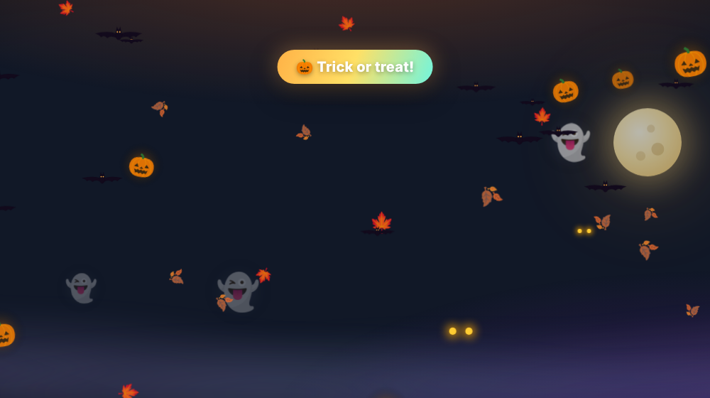
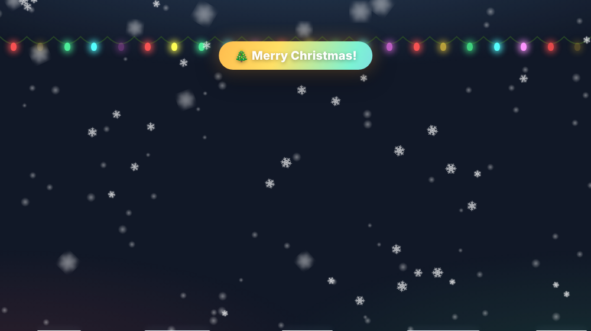
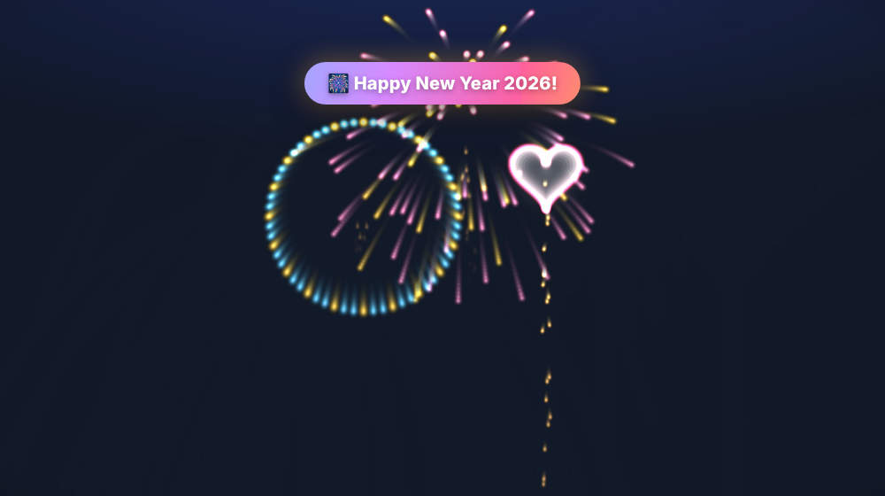
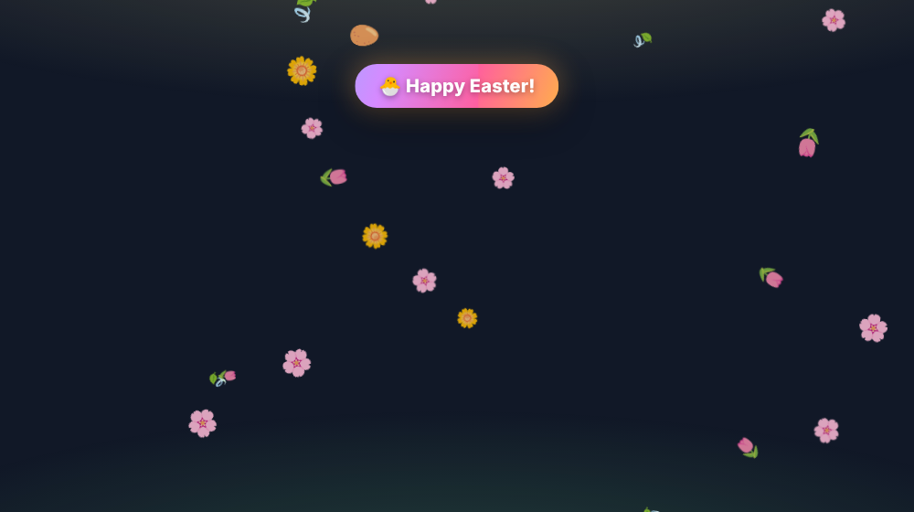
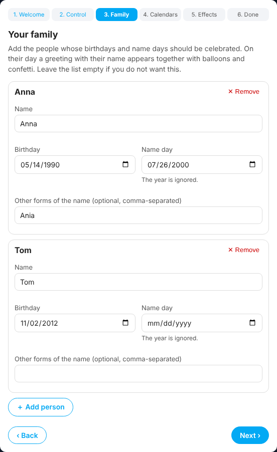
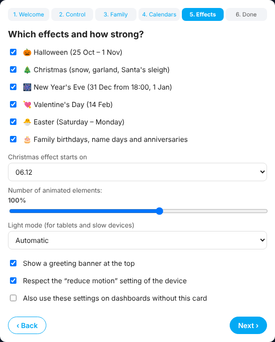

# ✨ Seasonal Effects for Home Assistant

[](https://hacs.xyz/docs/faq/custom_repositories)


Animated seasonal effects drawn on top of your Lovelace dashboards – **Halloween, Christmas, New Year's Eve, Valentine's Day, Easter** and **your family's birthdays, name days and anniversaries**. Everything is set up with a friendly **step-by-step wizard** – no YAML needed.

🇵🇱 [Polski opis niżej](#-po-polsku)

| Halloween | Christmas | New Year's Eve |
|---|---|---|
|  |  |  |
| **Valentine's Day** | **Easter** | **Birthday / name day** |
|  |  |  |

## Features

- 🎃 **Halloween** (25 Oct – 1 Nov): bats, pumpkins, ghosts, falling leaves, a moon, fog, glowing eyes, lightning and a spider on a thread.
- 🎄 **Christmas** (from 6 Dec – configurable – until 6 Jan): three layers of snow, a blinking garland, a growing snowbank, shooting stars and Santa's sleigh.
- 🎆 **New Year's Eve** (31 Dec from 18:00 and 1 Jan): fireworks with trails (peony, willow, ring, crackle, heart) and a **10-second countdown to midnight**.
- 💘 **Valentine's Day** (14 Feb): floating, pulsing hearts.
- 🐣 **Easter** (Saturday – Monday, the date is calculated automatically): flowers, eggs and a hopping bunny.
- 🎂 **Family occasions**: balloons and confetti with a greeting **with the person's name** on their birthday or name day. Can also read **birthdays and anniversaries from your calendars** and a **name-day sensor**.
- 🧙 **Setup wizard** in the card editor: language, control helper (created for you with one click), family members, calendars, effects and performance.
- 🎛️ Optional **dropdown helper** to switch the effect from any dashboard or automation: *Auto / Off / Halloween / Christmas / New Year / Valentine's Day / Easter / Birthday*.
- 📱 **Light mode** for wall tablets and slow devices (detected automatically), adjustable number of elements, respects the *reduce motion* setting.
- 👆 The overlay **never blocks taps or clicks** – your dashboard works as usual.
- 🌍 English and Polish (greetings and wizard). All processing is local.

## Installation

### HACS (recommended)

1. Open **HACS** → menu **⋮** → **Custom repositories**.
2. Add `https://github.com/bobby6robert/ha-seasonal-effects` with the type **Dashboard**.
3. Find **Seasonal Effects** in HACS, click **Download** and reload the browser (Ctrl+F5 / clear the app cache on phones and tablets).

### Manual

1. Download `seasonal-effects.js` from the [latest release](https://github.com/bobby6robert/ha-seasonal-effects/releases/latest) and put it into `/config/www/`.
2. **Settings → Dashboards → ⋮ → Resources → Add resource**: URL `/local/seasonal-effects.js`, type **JavaScript module**.
3. Reload the browser.

## Setup

1. Open the dashboard where you want the effects, click **Edit dashboard → Add card** and search for **Seasonal Effects**.
2. The **wizard** opens. Go through the steps and click **Save**.
3. That's it – the effects now work on **every view of that dashboard**. The card itself is invisible (it only shows a small status box while you edit the dashboard). To change anything later, just edit the card again.

> Want the effects on several dashboards? Add the card to each of them, or tick *“Also use these settings on dashboards without this card”* in the wizard.

 

### Try it

Every effect can be previewed from the wizard or the status box. You can also run this in the browser console:

```js
seasonalEffects.preview('christmas', 20)   // halloween | christmas | newyear | valentine | easter | birthday
seasonalEffects.current()                   // what is shown now
```

## Configuration (YAML, optional)

The wizard writes this for you. For reference:

```yaml
type: custom:seasonal-effects-card
language: auto              # auto | en | pl
entity: input_select.seasonal_effects   # optional control helper
family:
  - name: Anna
    birthday: "1990-05-14"  # YYYY-MM-DD or MM-DD
    nameday: "07-26"        # MM-DD (optional)
    aliases: [Ania, Anka]   # other forms of the name, used with the name-day sensor
calendars:                  # optional – events with "birthday"/"urodziny" or "anniversary"/"wedding"/"rocznica"/"ślub"
  - calendar.family
nameday_entity: sensor.name_day   # optional – state = today's names, comma-separated
effects:
  halloween: true
  christmas: true
  newyear: true
  valentine: true
  easter: true
  birthday: true            # family birthdays, name days and anniversaries
christmas_start: "12-06"    # MM-DD
intensity: 1                # 0.3 – 1.5
lite: auto                  # auto | on | off
banner: true                # greeting banner at the top
reduced_motion: respect     # respect | ignore
all_dashboards: false
show_status: false          # show the status box on the dashboard all the time
```

### The control helper

The helper's options can be in English or Polish:

| Option | Meaning |
|---|---|
| `Auto` / `Automatycznie` | choose by date and family occasions |
| `Off` / `Wyłączony` | no effects |
| `Halloween`, `Christmas`/`Święta`, `New Year`/`Sylwester`, `Valentine's Day`/`Walentynki`, `Easter`/`Wielkanoc`, `Birthday`/`Urodziny` | always show that effect |

Example – turn effects off at night:

```yaml
automation:
  - alias: Seasonal effects off at night
    triggers:
      - trigger: time
        at: "22:00:00"
    actions:
      - action: input_select.select_option
        target:
          entity_id: input_select.seasonal_effects
        data:
          option: "Off"
```

## FAQ

- **Nothing happens.** Check that the resource is loaded (browser console shows `SEASONAL-EFFECTS 1.x.x`) and that the card is on the dashboard you are looking at. Outside the seasons nothing is shown – use the preview buttons to test.
- **The tablet is slow.** Set *Light mode* to *Always on* and lower the number of elements in the wizard.
- **Name days do not match.** Name-day sensors often return names in a different grammatical form. Add those forms to *Other forms of the name*.

## License

MIT © bobby6robert

---

## 🇵🇱 Po polsku

Animowane **efekty sezonowe** nad dashboardem Home Assistant: **Halloween, Święta, Sylwester, Walentynki, Wielkanoc** oraz **urodziny, imieniny i rocznice w rodzinie**, z życzeniami z imieniem. Wszystko ustawia **kreator krok po kroku**, bez YAML.

**Instalacja:** HACS → ⋮ → *Niestandardowe repozytoria* → dodaj `https://github.com/bobby6robert/ha-seasonal-effects` jako typ **Dashboard** → pobierz **Seasonal Effects** → odśwież przeglądarkę.

**Ustawienie:** edytuj dashboard → *Dodaj kartę* → **Seasonal Effects** → przejdź kreator (język, pomocnik do sterowania – kreator może go utworzyć jednym kliknięciem, rodzina z datami urodzin i imienin, kalendarze, czujnik imienin, wybór efektów i wydajności) → **Zapisz**. Efekty działają na wszystkich widokach tego dashboardu, a sama karta jest niewidoczna (widać ją tylko w trybie edycji).

**Pomocnik** (lista wyboru) pozwala przełączać efekty z dowolnego miejsca: *Automatycznie / Wyłączony / Halloween / Święta / Sylwester / Walentynki / Wielkanoc / Urodziny*.

Na tabletach ściennych efekty same przechodzą w **tryb lekki**. Warstwa efektów nigdy nie blokuje dotyku.
